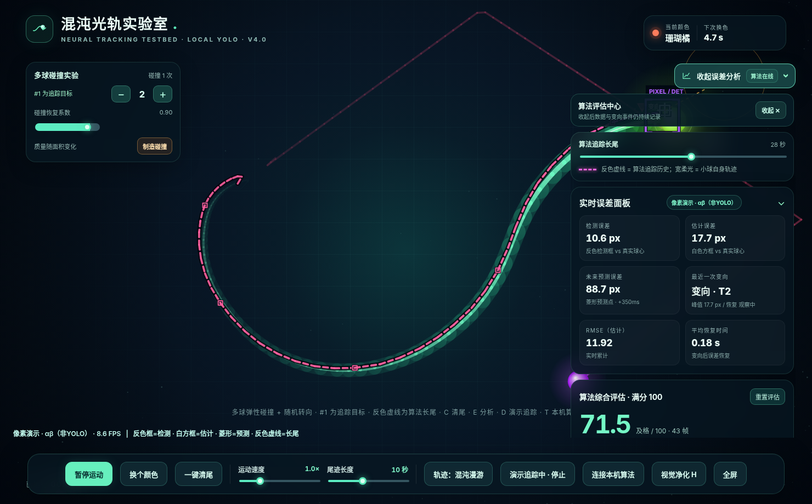

# 🎮 游戏宇宙 · Games Hub

> **七个可直接游玩的游戏入口**，包括原创本地双人《厨房大乱斗》；所有入口共用一个地址。可选的第三方厨房 C++ 原版另行构建。

本仓库由原 `four-games-hub` 整理而来，文件夹与仓库统一命名为 `games`。对外只暴露一个端口（默认 `3300`），围棋、五子棋与可选的 Python 视觉追踪服务只在 `127.0.0.1` 的内部端口运行，再由大厅同源转发。

## 七个世界

| 入口 | 核心内容 | 教学与算法 |
| --- | --- | --- |
| **围棋学堂** | 9/13/19 路棋盘、自由人机、真人联机房间 | 50 节课程、16 套方法论棋谱、可解释的启发式算法实验室 |
| **五子棋** | 双人联机房间、独立人机练习 | 12 节课程、启发式评分、评分教学 |
| **星阵：共振计划** | 3/5/7 路 GF(2) 翻转解谜 | 12 关、高斯消元、解空间维数与最少点击搜索 |
| **扫雷实验室** | 自定义棋盘尺寸与雷数、三种难度 | 12 节课程、不偷看雷位的逻辑助手 |
| **混沌光轨实验室** | 随机运动、1–8 球碰撞、霓虹长尾、检测/预测 | 10 节视觉追踪课程、α–β、OpenCV、Kalman、Hungarian MOT，可选训练 YOLO |
| **火柴人篮球（V0.4）** | 2D 俯视角 3v3 人机、运球、传球、投篮、抢断、24 秒 | 13 种动作、上篮/扣篮、变向突破、10 张战术卡、投篮概率、碰撞与三档 AI 难度；**十人联机尚未实现** |
| **厨房大乱斗（V0.1）** | 原创 2D 同屏双人合作，切菜、炖汤、装盘、倒计时接单 | 单人／双人键盘、两道配方、烧焦与订单超时、结算评分；联网仍在规划 |

## 🍳 厨房大乱斗：原创游戏已可直接游玩

**真正可玩的浏览器游戏现已接入大厅。** 无需 Emscripten、无需额外下载素材，打开 [http://localhost:3300/play/kitchen/](http://localhost:3300/play/kitchen/) 即可选择单人练习或双人同屏合作。

- **厨师 1：** WASD 移动，E 交互，按住 Space 切菜。
- **厨师 2：** 方向键移动，Enter 交互，按住右 Shift 切菜。
- **目标：** 在 150 秒营业时间内完成🥗双蔬沙拉和🍲蘑菇汤等限时订单；用传递台协调、装盘台完成料理、服务台送餐，避免订单超时及汤烧焦。
- **技术：** 原生 Canvas 2D + 独立可测试的 JavaScript 规则引擎；无第三方运行依赖。手机提供单人触控按钮。
- **限制：** 目前支持单人、本地双人同键盘；在线多人和 AI 厨师尚未实现。

另外，旧版导入的 [Taste from Another Place](https://github.com/mikegiannako/taste-from-another-place) MIT 原版 C++/raylib 源码**原样保留**在 apps/kitchen-chaos/vendor。它是单人游戏，不等于我们新写的双人玩法；想尝试其 WebAssembly 版本，可运行 bash scripts/build-kitchen-open-source.sh 并访问 /play/kitchen/upstream/。原版音频与美术不随仓库重新发布。详情见 [厨房项目 README](apps/kitchen-chaos/README.md)。

> 混沌光轨是运动与视觉算法实验项目，不是已实现多人房间的竞技游戏。浏览器演示、经典视觉检测和训练后的 YOLO 是三种不同实现，界面中会明确区分。

<p align="center">
  
</p>

## 技术栈

- **入口网关**：Node.js 原生 `http` 服务器 + 同源反向代理 + WebSocket 升级转发（`hub/server.mjs`）
- **围棋 / 五子棋前端**：React 18 + TypeScript + Vite
- **实时对战**：Socket.IO
- **大厅、课程与星阵**：原生 HTML / CSS / JavaScript ES 模块，零前端构建依赖
- **可选视觉算法**：Python、NumPy、OpenCV、SciPy；可选 ultralytics / YOLO 训练

## 快速开始

### 环境要求

- Node.js **>= 20**，npm **>= 10**（`start.sh` 会检查）
- Linux 推荐；macOS 通常可用；Windows 建议 WSL
- 首次启动需要联网安装围棋/五子棋前端依赖
- 可选：Python 3，用于混沌光轨的本机视觉追踪

### 一键启动

```bash
git clone https://github.com/David-tiao/games.git
cd games
./start.sh
```

首次运行会：

1. 检查 Node.js 版本与 `3300` 端口；
2. 执行旧账号数据安全迁移检查（只复制，不删除）；
3. 若缺少依赖，为 `apps/go-online` 和 `apps/gomoku-online` 执行 `npm install`；
4. 构建这两个 React 客户端；
5. 启动统一大厅，并拉起内部后端。

启动后访问：

- 本机：<http://localhost:3300>
- 同一局域网的朋友：<http://你的电脑IP:3300>

如果端口被占用：

```bash
PORT=3301 ./start.sh
```

停止服务：在启动终端按 `Ctrl+C`。

### 可选的 `games` 启动命令

```bash
./scripts/install-launcher.sh
```

重新打开终端后即可用 `games` 启动大厅。它会写入 `~/.local/bin/games`，指向当前仓库的 `start.sh`。

## 开发与验证

```bash
# 语法检查
npm run check

# 全套测试（根测试 + 围棋 + 五子棋 + 星阵）
npm test

# 单独运行星阵测试（无需 npm install）
cd apps/star-array && npm test
```

如果安装了可选的 Python 追踪环境，还可以运行：

```bash
./scripts/install-ball-tracker.sh
apps/neon-ball-lab/.venv/bin/python -m pytest -q apps/neon-ball-lab/tests
```

## 可选的 Python 视觉追踪

混沌光轨默认可直接在浏览器里演示亮白核心检测 + α–β 估计，不需要 Python。若需要本机 OpenCV + Kalman + Hungarian MOT：

```bash
./scripts/install-ball-tracker.sh
```

然后按 `Ctrl+C` 停止大厅并重新运行 `./start.sh`。大厅会在检测到 `apps/neon-ball-lab/.venv/bin/python` 且依赖齐全时自动启动追踪服务。

可用环境变量：

- `BALL_PYTHON`：指定 Python 解释器路径；
- `BALL_TRACKING_MODE`：`hybrid`（默认）、`classical` 或 `yolo`；
- `CORS_ORIGINS`：限制允许访问后端 API 的来源，公网部署时应设置。

**注意**：仓库不包含训练好的 YOLO 权重。训练脚本、数据生成脚本与说明在 `apps/neon-ball-lab/` 中，需自行训练 `best.pt` 后才能启用真正的 YOLO 模式。未训练时系统会明确使用经典视觉检测，不会伪装成 YOLO。

## 项目结构

```text
games/
├── start.sh                     # 一键启动入口
├── package.json                 # 顶层脚本：check / test / build
├── hub/
│   ├── server.mjs               # 唯一对外端口、反向代理、WebSocket 转发
│   ├── public/                  # 大厅首页与全屏容器
│   └── learning/                # 五子棋、扫雷、混沌光轨课程页面
├── apps/
│   ├── go-online/               # 围棋源码 + 可选账号数据目录
│   ├── gomoku-online/           # 五子棋源码 + 可选账号数据目录
│   ├── basketball/              # 2D 篮球 3v3 / 投篮模型与战术卡
│   │   ├── engine.mjs         # 可测试的纯 JS 比赛规则
│   │   ├── game.js            # Canvas 渲染与控制
│   │   ├── stickman.mjs       # 火柴人骨架、跑步/投篮/盖帽姿势
│   │   ├── style.css          # 球场界面与手机交互
│   │   └── index.html         # 篮球全屏入口
│   ├── star-array/              # GF(2) 星阵解谜
│   ├── kitchen-chaos/           # 原创双人烹饪游戏 + 保留 MIT 第三方源码
│   └── neon-ball-lab/           # 混沌光轨源码、视觉算法与训练工具
├── scripts/                     # 启动器、迁移、依赖安装脚本
├── tests/                       # 大厅与课程页面测试
├── docs/                        # 开发范围与版本规划
└── data/                        # 迁移日志（运行时生成，不入库）
```

## 数据、隐私与安全

- 账号数据保存在 `apps/go-online/server/data/users.json` 和 `apps/gomoku-online/server/data/users.json`。这些文件**不会**提交到仓库；仓库只保留 `.gitkeep` 占位文件。
- `.env` 与 `.env.*` 不会提交；`apps/go-online/.env.example` 和 `apps/gomoku-online/.env.example` 仅作为配置参考。项目通过环境变量读取配置，不会自动加载 `.env` 文件。
- 默认仅适合局域网使用。若要把 `3300` 暴露到公网，请放在 HTTPS 反向代理之后，并增加认证、访问控制与 `CORS_ORIGINS` 限制。
- 仓库不包含任何真实账号、密码哈希、API 密钥或训练好的模型权重。

## 已知限制

- 厨房目前是本地双人（同键盘），没有在线多人；其第三方 C++ 原版移植属于独立可选构建。

- 围棋与五子棋仍是两套独立账号，没有统一登录。
- 星阵的十人实时协作、服务端 7 天存档尚未实现；当前只是单人核心玩法。
- 火柴人篮球 V0.4 当前是 3v3 本地 AI 比赛，不能与朋友实时对战；未来再做联网与服务端比赛。
- 混沌光轨的 100 分评分针对 #1 球的单目标评估，不是完整的 MOT 指标。
- 所有 AI/老师提示均为启发式规则，不代表胜率或职业级最优变化。
- 扫雷逻辑助手不会读取隐藏雷位，只基于已揭开的格子做约束推断。

## 版本历史

- **V1.9（厨房大乱斗可玩版）**：原创 Canvas 本地双人/单人烹饪游戏上线，含沙拉/汤、切菜、烹饪、装盘、限时订单和分数结算；保留原版 MIT C++ 代码及可选构建入口。

- **V1.8（厨房开源项目移植预览）**：按 MIT 许可证导入 Taste from Another Place 原版 30 个 C++/raylib 源码及构建文件，保留版权，并增加原版媒体获取、Emscripten 构建适配、同域预览路由。不是已经完成的本地双人/联网游戏。

- **V1.7（火柴人篮球 V0.4）**：新增 C 运球变向、L 上篮与扣篮、体力和冷却、近身防守晃动、13 种火柴人动作与 10 张战术卡；另补充开源合作厨房游戏调研。

- **V1.6（火柴人篮球 V0.3）**：将篮球场内圆形球员升级为火柴人骨架，加入跑步/运球/蓄力/跳投/传球/抢断/封盖/篮板/受撞动作，保持原有 3v3 AI 与规则。

- **V1.5（篮球 V0.2）**：球员碰撞分离、近身时机封盖、抛物线及光效、篮板计时 14/24 秒、三档 AI 难度、暂停和终场出手规则。

- **V1.4（篮球预览）**：新增《篮球：全场掌控》2D 3v3 人机、投篮概率和战术卡；不包含十人联网。

- **V1.3**：扫雷支持三种棋盘分别自定义雷数；保留全屏布局与课程。
- **V1.2**：混沌光轨 V4.1 合并、10 节视觉追踪学院、可选 Python 同域代理、追踪会话隔离。
- **V1.1**：沉浸式全屏与算法面板抽屉。
- **V1.0**：四款游戏初次统一。

## License

本仓库未指定开源许可证。若需分发或二次开发，请先补充合适的 LICENSE 文件。
