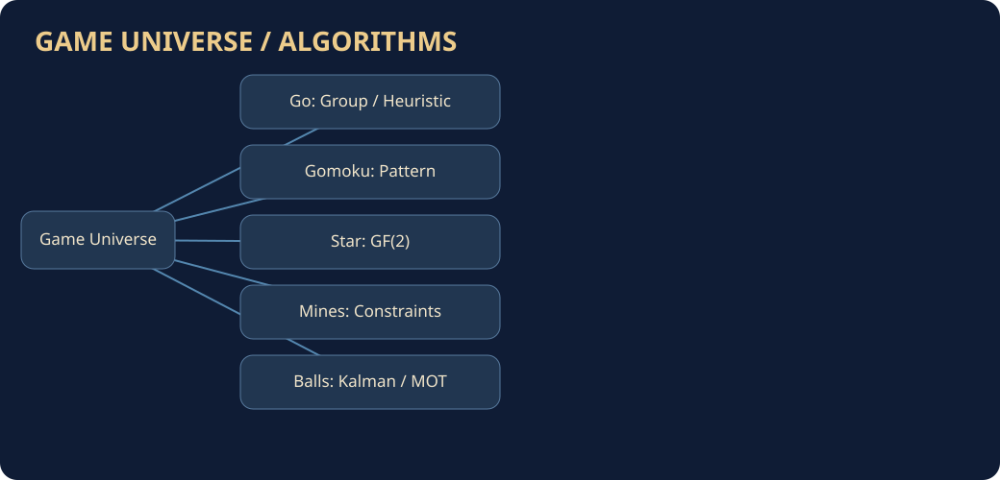
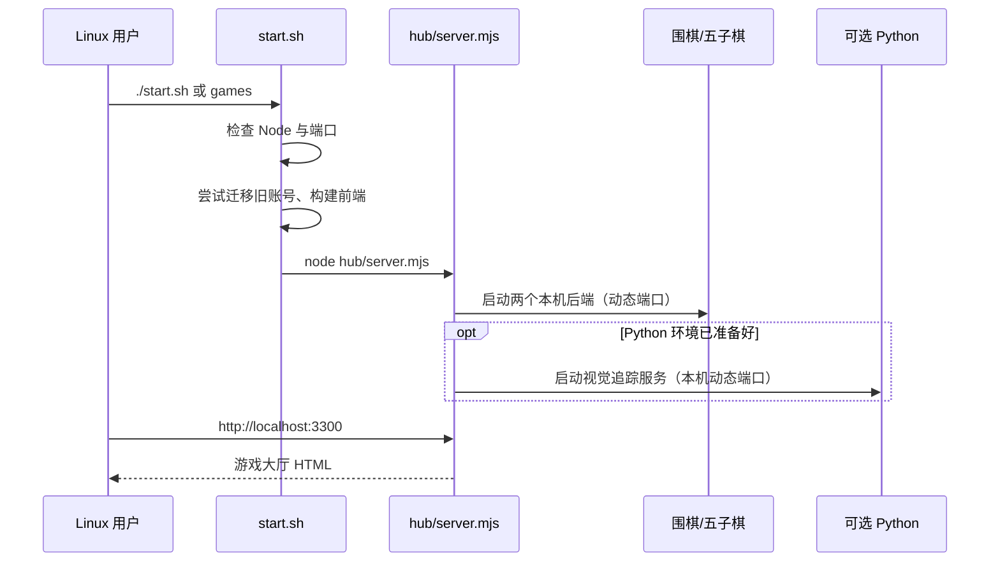

# 00｜总体摘要：五个世界是如何组成一个游戏宇宙的？

## 一句话说明

这不是一款游戏里面装了五个小玩法，而是：**一个浏览器大厅、两个独立实时对弈后端、两个静态解谜页面、一个可选 Python 算法后端**，通过同一个 HTTP 网关组合成的五入口系统。

## 系统组成图

```mermaid
flowchart TB
  U[玩家：电脑或手机浏览器] --> G[Game Universe 大厅 3300]
  G --> GO[围棋学堂：联机、AI、50课]
  G --> GM[五子棋：联机、人机、12课]
  G --> ST[星阵：GF\(2\) 解谜]
  G --> MI[扫雷：自定义雷数 + 逻辑提示]
  G --> BA[混沌光轨：运动 + 视觉追踪]
  BA -.可选 Python.-> PY[OpenCV + Kalman + MOT]
```

## 为什么选这个架构？

1. **复用成熟代码**：围棋、五子棋此前有各自的服务端权威对局逻辑，不为做大厅而重写。
2. **入口统一**：玩家访问 `http://主机IP:3300`，不用记五个网址；内部子服务绑定回环地址。
3. **算法独立**：GF(2) 求解器、扫雷约束推理、五子棋评分函数、围棋评分账本和 Python 追踪都能单独测试。
4. **逐步演进**：目前不是全平台统一账号/数据层，将来增加它们时不应破坏游戏规则内核。
5. **部署简单**：Linux 有 `./start.sh` 和可选 `games` 命令；浏览器里能玩不依赖 Python 的内容。



## 五类算法的根本差异

| 游戏 | 状态对象 | 典型算法 | “最优”能否证明 | 主要限制 |
|---|---|---|---|---|
| 围棋 | 棋盘、历史局面、气 | 连通块搜索、合法性过滤、启发式排序 | 启发式 AI **不能证明** | 不等于专业围棋引擎 |
| 五子棋 | 15×15 黑白落子 | 四方向连续段、开放端计数、启发式 | 当前版本**不能证明** | 没有通用深度博弈搜索 |
| 星阵 | 二进制向量 | GF(2) 消元、零空间、Gray Code 枚举 | 零空间维数在阈值内**可证明** | 大维数仅返回可行解 |
| 扫雷 | 数字、旗帜、未知格 | 方程约束传播、集合包含关系 | 部分格子**可逻辑证明** | 推不出时不强猜；旗帜当作假设 |
| 混沌光轨 | 像素帧、检测框、轨迹 | α–β、KF、Hungarian、可选 YOLO | 属于统计估计，不存在必赢 | 遮挡与碰撞会造成误差和 ID 切换 |

## 现在具备什么，还缺什么？

**已具备：** 五入口、同域游戏导航、全屏界面、双人围棋与五子棋、独立账号、五套算法或课程、扫雷自定义雷数、混沌光轨可选 Python 追踪。

**未具备：** 跨五款游戏的统一身份、十人共享同一张星阵、统一持久化服务端存档、真正的“成功保存后 168 小时自动删除”制度。不要将账号会话的七天过期与七天存档混为一谈。

## 阅读建议

- **架构维护者**：01 → 02 → 03 → 04 → 11 → 12 → 13。
- **算法爱好者**：07（代数）→ 08（约束）→ 06（启发式博弈）→ 05（围棋规则）→ 09（概率估计）。
- **游戏界面开发**：10 → 01 → 03；修改算法交互时再读相应算法专章。
- **第一次部署**：12 → 11 → 04；请先备份账号数据。

## 一次正常启动的生命周期



## 本文档的可信范围

以 V1.3 压缩包中源码为依据。文档不保证用户电脑上安装的项目未被后续手动修改；如代码与说明不一致，以本机源码和运行结果为准，并补充文档变更记录。
