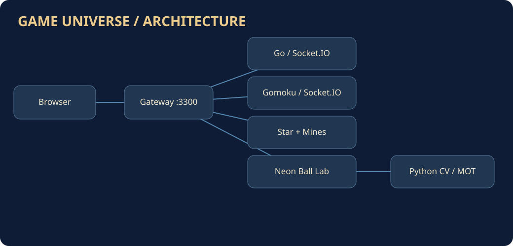
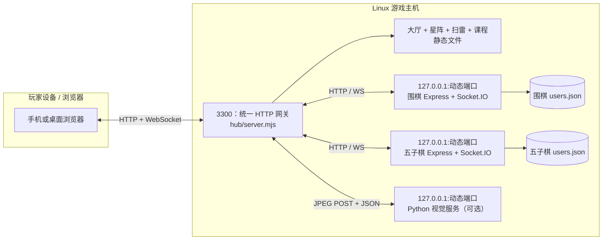

# 01｜系统架构：统一网关 + 独立游戏内核

> 图片还提供 Graphviz 源文件：`assets/platform-architecture.dot`；下文另有可编辑 Mermaid 组件图。

## 1. 架构风格与技术选型

**当前形式：单机多进程集成式网关（process-orchestrated modular application）**。不像 Kubernetes 微服务，也不是所有功能集中写在同一个 React 程序里。

| 层次 | 技术与文件 | 职责 |
|---|---|---|
| 游戏大厅 | 原生 HTML/CSS/JS：`hub/public/` | 游戏导航、全屏 iframe、少量语言/主题偏好 |
| 网关 | Node.js 原生 `http`：`hub/server.mjs` | 3300 静态内容、路由代理、WebSocket 升级、启动本地子进程 |
| 围棋 | React + TypeScript + Vite；Express + Socket.IO | 双人实时房间、账号、围棋规则与教学 |
| 五子棋 | React + TypeScript + Vite；Express + Socket.IO | 双人对战、账号与棋局状态 |
| 星阵 | 原生 JS + 浏览器模块 + 静态 Node 资源 | 纯前端 GF(2) 求解与关卡；由网关提供页面 |
| 扫雷 | 原生 JS/HTML + JS 算法模块 | 纯前端扫雷逻辑与教学 |
| 混沌光轨 | Canvas + JS；可选 Python/OpenCV/NumPy/SciPy | 浏览器动画，选配视觉检测与多目标追踪 |
| 数据 | 围棋/五子棋独立 JSON 文件与浏览器 localStorage | 账号持久化；其他偏好/进度按应用存储 |

## 2. 组件部署图

**边界条件：** “对外只开放一个 3300”表示本工程统一监听的入口，不保证 Linux 上其他软件没有端口，也不表示公网可安全直接暴露。内部围棋/五子棋/Python 服务绑定 `127.0.0.1`。

## 3. 为什么网关要代理 WebSocket？

浏览器路径为 `/play/go/socket.io/...` 或 `/play/gomoku/socket.io/...`；网关会把 HTTP 请求与 WebSocket upgrade 转发给相应后端。否则即使 React 网页打开，真人房间也可能无法同步。关键函数：`routeProxy`、`proxyHttp`、`proxyUpgrade`。

## 4. URL 路由表（V1.3）

| 浏览器 URL | 实际来源 | 说明 |
|---|---|---|
| `/` | `hub/public/index.html` | 大厅 |
| `/assets/*` | `hub/public/assets/*` | 大厅样式和脚本 |
| `/play/go/*` | 围棋内部服务 | React + API + Socket.IO |
| `/play/gomoku/*` | 五子棋内部服务 | React + API + Socket.IO |
| `/play/star/` | `apps/star-array/client/index.html` | 星阵页面 |
| `/play/star/client/*`、`/play/star/shared/*` | 星阵模块 | 浏览器 ESM 依赖 |
| `/play/mines/` | `hub/learning/mines.html` | 扫雷游戏与算法抽屉 |
| `/learn/mines/` | 同一 `mines.html` | 扫雷课程入口 |
| `/learn/gomoku/` | `hub/learning/gomoku.html` | 五子棋教学 AI 与 12 课 |
| `/play/balls/` | `apps/neon-ball-lab/index.html` | 浏览器实验室 |
| `/learn/balls/` | `hub/learning/balls.html` | 10 课视觉追踪学院 |
| `/play/balls/frame`、`/play/balls/health` | Python 内部服务（可选） | 同域算法代理 |
| `/api/health`、`/api/services` | 大厅网关 | 网关与子服务状态 |

## 5. 运行时进程与生命周期

1. `start.sh` 检查 Node.js 主版本、3300 是否被占用。
2. 运行旧数据/权重迁移脚本；检查围棋/五子棋依赖；必要时 `npm install`。
3. 对两个 React 客户端分别进行 TypeScript 检查 + Vite 正式构建。
4. `exec node hub/server.mjs`：网关启动并对外监听 `0.0.0.0:PORT`。
5. 网关为围棋和五子棋挑选本机空闲端口并启动 Node 子进程。
6. Python 可用且 `cv2,numpy,scipy` 能导入时，按配置启动本机 Python 服务。
7. 网关退出时尝试向子进程发送 `SIGTERM`；账号数据不会在这一阶段被删除。

### 启动失败与降级

- 围棋/五子棋后端退出：对应路径暂时返回 502/503，网关和其他游戏可能仍可用。
- Python 未安装：**混沌光轨浏览器演示仍能用**，`/play/balls/frame` 返回不可用信息。
- 3300 已占用：`start.sh` 给出提示，建议先查旧服务或改用 `PORT=3301`。

## 6. 技术选型的取舍

**优点**：代码复用、单入口、无需容器、单台电脑易操作、可把原算法独立测试。  
**代价**：账号和状态尚不统一；多个子进程需管理；浏览器本地设置不会自动同步；网关不是生产级的限流、TLS 和审计系统。

## 7. 架构稳定性约定

- **业务状态的权威所有者**：围棋/五子棋后端，不是大厅 iframe；星阵/扫雷目前是浏览器本地状态。
- **同源约定**：用户浏览器内不能连接用户自己的 `127.0.0.1` 作为服务端；视觉追踪必须通过 `/play/balls/frame` 代理。
- **部署边界**：房间内存状态在服务进程重启后消失；账号 JSON 仍然保留。
- **未来升级**：统一账号、SQLite、十人星阵房间和七天存档属于后续架构改造，不应写成当前已实现。
