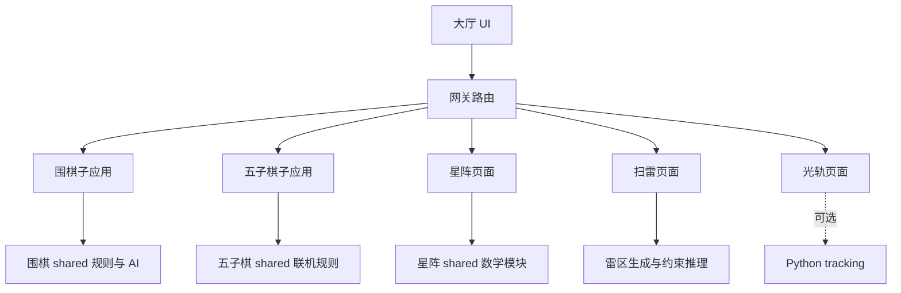

# 02｜源码目录、模块职责与改动路线

## 主目录图

```text
four-games-hub/
├── README.md                       # 项目使用说明
├── package.json                    # 根测试 / 检查 / 构建入口
├── start.sh                        # Linux 一键启动
├── hub/
│   ├── server.mjs                  # 3300 网关、HTTP/WS 代理、子进程
│   ├── public/
│   │   ├── index.html              # 五款游戏大厅
│   │   └── assets/{main.js,style.css}
│   └── learning/
│       ├── gomoku.html             # 五子棋 AI / 课程
│       ├── mines.html              # 扫雷游戏 + 逻辑学院
│       ├── balls.html              # 视觉追踪学院
│       └── assets/
│           ├── gomoku-ai.js        # 五子棋评分核心
│           ├── gomoku-page.js      # AI 页面交互
│           ├── mine-config.js      # 雷数校验、首击安全埋雷
│           ├── mines-ai.js         # 已知数字约束推理
│           └── learning.css
├── apps/
│   ├── go-online/
│   │   ├── shared/{goRules.js,goCoach.js,goLessons*.js,goMethodology.js}
│   │   ├── client/src/{academy,algorithm,methodology,components,i18n}/
│   │   ├── server/src/{index.js,auth.js,roomManager.js}
│   │   ├── server/data/            # 账号 JSON 目录（真实数据需保护）
│   │   └── docs/                   # 原围棋专属文档
│   ├── gomoku-online/
│   │   ├── shared/gameRules.js
│   │   ├── client/src/
│   │   ├── server/src/{index.js,auth.js,roomManager.js}
│   │   └── server/data/            # 独立账号数据
│   ├── star-array/
│   │   ├── shared/{math.js,levels.js}
│   │   ├── client/{index.html,app.js,style.css}
│   │   ├── server/index.js         # 原独立版运行服务
│   │   └── tests/math.test.js
│   └── neon-ball-lab/
│       ├── index.html              # Canvas 小球及浏览器视觉演示
│       ├── local_server.py         # 本机视觉服务与会话状态
│       ├── tracker.py              # 单目标 6 状态 KF
│       ├── mot_core.py             # 多目标 KF + Hungarian
│       ├── mot_video.py            # 多目标视频离线演示
│       ├── compare_builtin.py      # ByteTrack / BoT-SORT 对照
│       ├── train_yolo.py           # 可选训练
│       ├── generate_dataset.py     # 合成训练数据
│       ├── generate_multi_dataset.py
│       └── tests/
├── scripts/
│   ├── install-launcher.sh         # 生成 ~/.local/bin/games
│   ├── migrate-old.sh              # 老账号复制（需核对路径）
│   ├── migrate-ball-weights.sh     # 旧权重复制
│   ├── install-ball-tracker.sh     # 安装可选 Python venv
│   └── cleanup-old.sh              # 清理旧项目；谨慎运行
├── tests/                          # 大厅整合测试
└── docs/                           # 本文档库
```

## 变更什么功能，应该修改哪一层？

| 需求 | 首选变更位置 | 必须回归哪些测试 |
|---|---|---|
| 大厅新增游戏卡片 | `hub/public/index.html` + `hub/public/assets/main.js` | `tests/ball-integration`、全屏相关测试 |
| 统一网址和代理 | `hub/server.mjs` | HTTP/Socket.IO 访问、端口和身份测试 |
| 围棋规则 | `apps/go-online/shared/goRules.js` | `goRules` + `roomManager` + 教学测试 |
| 围棋 AI 评分 | `apps/go-online/shared/goCoach.js` | `goCoach` + `algorithmLab` |
| 五子棋真人五连 | `apps/gomoku-online/shared/gameRules.js` | `gameRules` + `roomManager` |
| 五子棋教学 AI | `hub/learning/assets/gomoku-ai.js` | `tests/algorithms.test.mjs` |
| 星阵求解器 | `apps/star-array/shared/math.js` | `apps/star-array/tests/math.test.js` |
| 扫雷自定义雷数 | `hub/learning/assets/mine-config.js`、`mines.html` | `tests/custom-mines.test.mjs` |
| 扫雷推理 AI | `hub/learning/assets/mines-ai.js` | `tests/algorithms.test.mjs` |
| 追踪算法 | `apps/neon-ball-lab/{tracker.py,mot_core.py}` | Python tests + 图像转发集成测试 |
| 教学页 UI | `hub/learning/` | 桌面/手机真实浏览器交互 |

## 依赖方向图



### 不应跨越的边界

- 不要在 CSS/动画层实现权威胜负判定；围棋、五子棋必须由服务器检查落子。
- 不要让扫雷提示读取隐藏 `mine` 字段，推理函数只接收 `visible`。
- 不要让 Python 追踪器读取浏览器物理球的真实坐标，避免评估泄漏。
- 不要通过覆盖 ZIP 自动删除任何旧的 `server/data` 数据文件。

## 原有资料继续保留

围棋 `apps/go-online/docs/{ALGORITHM_LAB.md,METHODOLOGY.md,50_LESSONS.md,PROJECT_STRUCTURE.md}`、混沌光轨 `apps/neon-ball-lab/{README.md,ALGORITHMS.md}` 提供更细的原作者级说明。本文档库是全局入口，不取代上述专用文件。
