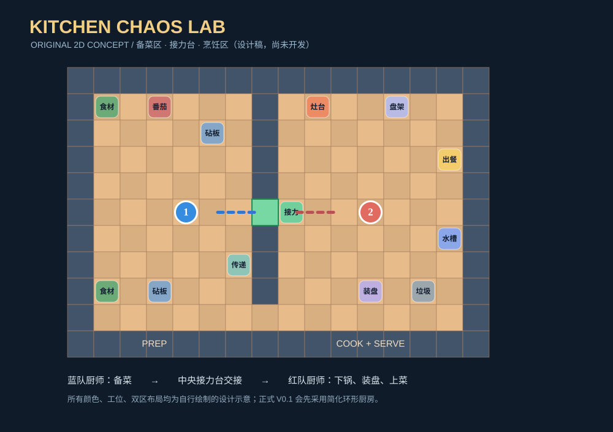

# 17｜《厨房大乱斗》游戏设计文档（GDD）

> 版本：**V0.1 已实现 + V0.2 后续规划**。Game Universe V1.9 已上线原创 Canvas 双人同屏厨房游戏：切菜、炖汤、装盘、订单、接力台与结算可用。另保存 MIT 许可的 Taste from Another Place 原版单人 C++ 源码，WebAssembly 版仍须单独构建。联网、AI、故障地图仍为规划。
>
> 中文名：《厨房大乱斗》；英文名：**Kitchen Chaos Lab**。定位：浏览器 2D 俯视角、1–4 人合作烹饪、厨房突发事件、可解释 AI 与教学。参考但不复刻商业《胡闹厨房》，使用原创角色、地图、美术、声音和菜谱。

**相关文档：** [16 开源调研](16_合作厨房开源项目调研.md) · [18 架构与算法](18_厨房大乱斗_技术架构与算法.md) · [19 开发路线](19_厨房大乱斗_实施路线与验收.md)

## 1. 游戏概念

两名厨师在紧凑的厨房里接收订单、取材料、切菜、下锅、装盘和上菜。订单有倒计时，工位有占用和处理进度，一盘菜要经过多道工序；合作效率决定得分。

**区别于现成厨房游戏的原创机制：** “**双区厨房接力**”。不同厨师可负责备菜和烹饪，用中央传递台交接食材；后续增加传送带故障、洒水路障和临时客人加单。赛后除了总分还解释路径浪费、工位瓶颈和队友配合。这些玩法由我们自主编写，不直接复制上游代码与素材。

~~~mermaid
flowchart LR
  Order[订单出现] --> Get[领取食材]
  Get --> Chop[切菜/加工]
  Chop --> Cook[可选烹饪]
  Cook --> Plate[装盘/组合]
  Plate --> Serve[出餐口提交]
  Serve --> Score[得分/连击/新订单]
  Score --> Order
  Cook -->|过时未取| Burn[烧焦/丢弃]
  Burn --> Get
~~~

## 2. 第一版现有玩法与后续增强

**V0.1 先做本地同屏双人，兼容单人练习。** 一个人也能独立做菜；有朋友时同一台电脑双人合作。以后再加入 AI 厨师、真实在线多人房间。

| 项目 | V0.1 设计目标 |
|---|---|
| 时长 | 150 秒正式局 / 90 秒练习局 |
| 地图 | 16×11 瓦片，48px 每格，第一张为环形教学厨房 |
| 玩家 | 单人、双人同键盘；暂无联网 |
| 移速 | 4 格/秒，格内平滑移动 |
| 订单 | 初始 2 单、最多 3 单，每约 22 秒出现新单 |
| 持物 | 每位厨师最多携带一件食材/餐盘/成品 |
| 工位 | 食材箱、砧板、灶台、盘架、装盘台、出餐口、垃圾桶、中央传递台 |
| 规则 | 工位占用、物品唯一归属、加工进度、订单过期、正确配方 |
| UI | 完整菜谱提示、计时条、人物持物、加工进度、结算分析 |
| 语言 | 中文、英文，支持暂停、可关闭音效和动效 |

## 3. 键盘和触摸交互

| 动作 | 玩家 1 | 玩家 2 |
|---|---|---|
| 移动 | W/A/S/D | 方向键 |
| 拾取、放置、交互 | E | Enter |
| 持续切菜/搅拌 | Space（长按） | 右 Shift（长按） |
| 向相邻传递台交物 | Q | 右 Ctrl |
| 暂停 | P | P |

设计避免用 F 作为主要交互键，因为游戏大厅已经约定 F 用于全屏切换。所有按键应在游戏 iframe 内处理、阻止方向键滚动。移动端第一版可先提供单人横屏触摸操作；双人同屏手机需另做交互适配，不可承诺为 V0.1 已完成。

## 4. 两道首发菜谱

| 菜名 | 必须完成的任务依赖 | 基础分 | 限时 |
|---|---|---:|---:|
| 🥗 双蔬沙拉 | 取生菜→切；取番茄→切；两者+干净盘→装盘→送餐 | 100 | 50 秒 |
| 🍄 蘑菇汤 | 取蘑菇→切；取洋葱→切；入锅烹煮 6 秒→装盘→送餐 | 140 | 70 秒 |

切菜建议长按操作 2 秒；灶台与砧板同时只能处理一份材料。蘑菇汤可在烹饪完成后超过 6 秒变焦糊，需丢弃重来。错误配方不可“蒙混上菜”；必须明确提示缺少哪些材料。

**未来菜谱（尚未实现）**：鸡蛋炒饭、星港汉堡、行星寿司等。需要建立同一份配方数据，而不是每个菜单独写一套判定。

## 5. 地图与独特机关

这是**原创概念布局示意**，不代表当前存在可玩的厨房地图。实际 V0.1 先做更简单的环形厨房，确保每个工位都能走到；第二张地图引入中央接力台与分区协作。

**未来地图与事件：**

- **初学者食堂**：固定工位、宽走道、适合学习拾取和装盘。
- **双区接力站**：备菜区与烹饪区相隔，中间必须交接；地图允许绕路，但成本高。
- **星际传送厨房**：定时传送带，预警 5 秒后短暂停机。
- **夜班故障厨房**：灶台过热、局部地面洒水，但必须提前预告并提供恢复手段。

事件需要确定性随机种子、UI 预告和可回放记录；第一版不增加太多干扰，以免难以验证基本烹饪体验。

## 6. 评分与失败反馈

出餐得分建议：

\[
Score = Base + \lfloor 40\times Remaining/Limit\rfloor +10\times\min(Combo,3)
\]

其中 `Base` 为菜谱基础分，`Remaining/Limit` 截断到 [0,1]，`Combo` 为连续正确送达数。订单到期扣 20 分，错误出餐扣 10 分；不能对同一个失败事件重复扣分。**V0.1 可先不做连击**，优先确保基础分和剩余时间奖励正确。

结算显示：总分、成功订单/过期订单、浪费食材次数、厨师移动距离、各工位空闲与等待时间。这些数据以后供算法学院分析“为什么一个队伍分工合理”。

## 7. 教学体系：18 课（规划）

| 章节 | 课数 | 课程重点 |
|---|---:|---|
| 基本操作 | 5 | 移动、朝向、拾取、放置、交接 |
| 配方与协作 | 5 | 切菜、炖汤、装盘、双人接力、订单优先级 |
| 团队策略 | 4 | 减少拥堵、任务分工、切换工位、事件应对 |
| 算法学院 | 4 | A* 寻路、配方 DAG、关键路径、AI 分工成本 |

“知识卡”和“可评分互动练习”必须区分：V0.1 已有操作指南，但引导关、可评分训练关与 18 课教学均尚未实现。

## 8. 参考项目与产权边界

- [Let's Cook!](https://github.com/aschahal/lets_cook)：Next.js + Phaser 3 的双人 2D 切菜、装盘、订单玩法；根目录未看到 LICENSE，**不能认定其源码可自由复制发布**。
- [Delixia](https://github.com/TriForMine/Delixia)：浏览器多人房间、定时订单、加工工位、脏盘等；其 Babylon.js 客户端为 **3D**，我们只参考架构思想。Apache-2.0。
- [Overcooked-AI](https://github.com/HumanCompatibleAI/overcooked_ai)：Python 合作烹饪与多智能体规划环境；适合算法分析，并不是直接可用的 2D 游戏源码。MIT。
- [ChefJeff](https://github.com/belchingleo/ChefJeff)：真人与 AI 一起做菜、任务沟通与评估。AGPL-3.0，复用代码前必须评估条款。

所有被实际引入的第三方代码、字体、图像、音乐应另建清单并逐项合规核验；本设计**没有直接复制上述项目的代码或素材**。

## 9. 清晰的 V0.1 验收标准

- 单人完成一份沙拉和一份汤，烹饪流程正确；两人可合作交接食材。
- 空手/持物/工位占用都不会造成物品复制、丢失或非法上菜。
- 正确、错误、过期订单得分可复现；同一随机种子和输入可回放。
- 所有工位邻接合法并可通过地图寻路访问。
- 游戏在 Linux 浏览器可打开，暂停、重试、返回游戏大厅有效。
- **验收通过前不把大厅改为“七款游戏”**。

下阶段读 [18 技术架构](18_厨房大乱斗_技术架构与算法.md) 与 [19 开发验收](19_厨房大乱斗_实施路线与验收.md)。
