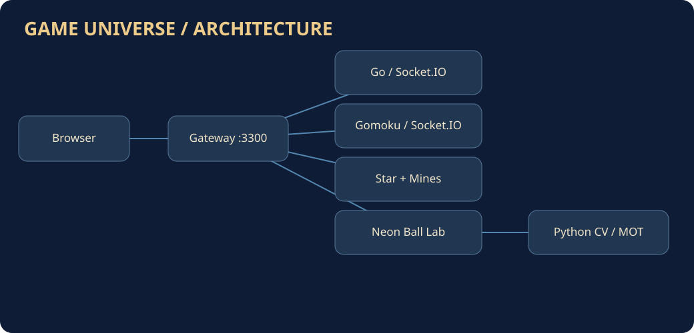

# Game Universe V1.7 — 技术文档总览

> 仓库：`https://github.com/David-tiao/games`，主分支 `main`。本地早期 ZIP 安装目录可能为 `~/Downloads/four-games-hub`，Git clone 目录通常为 `~/games`，以实际 `pwd` 为准。对应项目版本：Game Universe V1.7。
>
> 原则：**实现、可选算法环境、未来规划分开记载**。本目录包含系统架构、算法专题、数据与安全、测试和运维；现有 `ROADMAP.md` 保留不覆盖。

## 系统架构图

[Graphviz 源码](assets/platform-architecture.dot) · [五大算法分类图](assets/algorithm-taxonomy.svg)

## 从哪里开始

先读 **[00 总述](00_总述与模块导航.md)** → **[01 架构](01_系统架构.md)** → **[02 模块地图](02_目录与模块地图.md)**；研究数学和算法则阅读 05–09 并参考 14 速查；部署、测试和安全则阅读 11–13。

## 完整文档索引

| 章节 | 文档 | 涵盖内容 |
|---|---|---|
| 00 | [总述与模块导航](00_总述与模块导航.md) | 五个入口、算法边界、已实现与未实现、阅读路线 |
| 01 | [系统架构](01_系统架构.md) | 网关代理、子进程、Socket.IO、HTTP 路由、启动生命周期 |
| 02 | [目录与模块地图](02_目录与模块地图.md) | 工程结构、职责、源码入口、依赖方向和改动影响 |
| 03 | [网络与房间协议](03_网络与房间协议.md) | HTTP/WS、房间权限、状态机、重连与局域网访问 |
| 04 | [账号、数据与存档](04_账号数据与存档.md) | scrypt、独立账号、会话、备份、七天存档规划 |
| 05 | [围棋规则与 AI](05_围棋规则与AI.md) | 气、提子、劫、数子、候选点因素、50 课 |
| 06 | [五子棋规则与 AI](06_五子棋规则与AI.md) | 四向判胜、活棋形与攻防启发式、12 课 |
| 07 | [星阵线性代数](07_星阵线性代数.md) | GF(2)、高斯消元、零空间、Gray Code、最少点击 |
| 08 | [扫雷生成与约束推理](08_扫雷生成与约束推理.md) | 自定义雷数、首击安全、数字约束与集合差分 |
| 09 | [混沌光轨检测追踪](09_混沌光轨检测追踪.md) | α–β、OpenCV、卡尔曼、马氏门控、Hungarian、YOLO |
| 10 | [前端与课程体系](10_前端与课程体系.md) | 沉浸式全屏、抽屉面板、双语设置与教学 |
| 11 | [测试与验收](11_测试与验收.md) | 命令、性质测试、集成及真实浏览器验证 |
| 12 | [部署运维与排障](12_部署运维与排障.md) | Linux 启动、3300 端口、局域网、备份、构建 |
| 13 | [安全与演进计划](13_安全与演进计划.md) | 账号保护、联网安全、统一身份、七天存档、十人协作 |
| 14 | [数学公式与数据流速查](14_数学公式与数据流速查.md) | 跨游戏公式、数据流、源码速查、概念边界 |
| 15 | [火柴人篮球 V0.4](15_篮球2D运动与战术算法.md) | 13 种骨架姿势、上篮/扣篮、变向、防守与 3v3 AI |
| 16 | [合作厨房开源项目调研](16_合作厨房开源项目调研.md) | 开源多人厨房、许可证、可复用性与游戏架构建议 |
| 17 | [厨房大乱斗 · 游戏设计 GDD](17_厨房大乱斗_游戏设计.md) | **设计阶段**：原创玩法、双人键盘、菜谱、工位、地图、教学 |
| 18 | [厨房大乱斗 · 架构与算法](18_厨房大乱斗_技术架构与算法.md) | **设计阶段**：固定 tick、配方 DAG、A*、AI 分工及未来 Socket.IO 房间 |
| 19 | [厨房大乱斗 · 开发与验收](19_厨房大乱斗_实施路线与验收.md) | **设计阶段**：V0.1 至 V1.0、测试不变量、多人同步、上线门槛 |
| 原有 | [ROADMAP.md](ROADMAP.md) | 历史版本规划（原样保留） |

## 规划中的第七款：厨房大乱斗（尚未开发）

设计资料已纳入 `docs/17–19`，包括 [原创厨房布局示意图](assets/kitchen-relay-concept.svg)。**这只是设计和技术规划，不代表第七款已上线**；当前大厅保持六个入口，等 V0.1 确实可玩并通过验收后才修改。

## 六款游戏实现速览

| 游戏 | 已实现 | 联网状态 |
|---|---|---|
| 围棋学堂 | 9/13/19 路、双人对局、50 课、启发式 AI、算法实验室 | 双人真人房间 |
| 五子棋 | 15×15、双人对局、人机、12 课、评分讲解 | 双人真人房间 |
| 星阵 | 3/5/7 路、12 关、GF(2) 求解器和最优性报告 | 尚无十人协作 |
| 扫雷 | 自定义雷数、三种规模、12 课、可见信息逻辑推断 | 单人 |
| 混沌光轨 | 运动和碰撞、10 课、网页追踪、可选 Python MOT | 独立实验，不是十人共享房间 |
| 火柴人篮球 | 13 种骨架动画、上篮扣篮、变向、3v3 人机与 10 张战术卡 | 仅本地 AI，十人联机未实现 |

## 使用约定

- 00–14 是早期 V1.3 的架构基线，后续各章按对应版本维护；17–19 是尚未实现的厨房游戏设计。代码有后续提交时需重新核对差异。
- 本仓库尚未实现统一账号和成功保存后 168 小时删除的服务端存档制度；当前令牌过期不是存档过期。
- 无权重时的浏览器或经典 OpenCV 检测**不是 YOLO**；算法热力图启发分**不是胜率**。
- 每次算法变更同步更新对应专章、测试和本总目录。公开仓库不得提交真实账户数据、密钥与私有模型权重。
